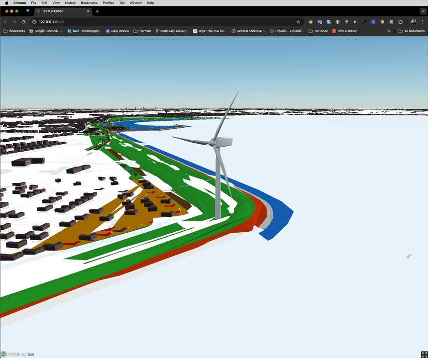

# Tile PostGIS tables to 3D Tiles

Use the project worker job **`create3dTiles`** (or Studio **Tile Server → Tables → Create 3D Tiles**) to run [pg2b3dm](https://github.com/Geodan/pg2b3dm) **2.27.0** against one PostGIS 3D table and upload an [OGC 3D Tiles 1.1](https://www.ogc.org/standards/3DTiles/) / glTF 2.0 tree to the private Storage bucket **`3dtiles`**.

This is **not** Mapbox Vector Tiles (MVT) and **not** the 2D Tile Server `{z}/{x}/{y}.pbf` endpoints. Those stay on [Tile Server](/tileserver).

This guide describes the worker and Studio surfaces that ship with the 3D Tiles later-surfaces work — not a claim that the Cesium preview is on production Studio today.

## Studio

1. Create a Storage bucket named **`3dtiles`** if it does not exist (Studio creates it when you run the action). The bucket is **private**.
2. Open your project → **Tile Server** → **Tables**.
3. Select one or more tables → **Create 3D Tiles**.
4. When the **3D** badge appears, click it to preview. Cesium is the proven viewer; MapLibre is an optional overlay.

Multi-table selection runs **one job per table**. Output: `3dtiles/{table}/tileset.json` plus implicit-tiling content.

The Studio preview and these docs use the Geodan / `geobase_3d_tiles_ideas` workshop sample: 3DBAG LoD1.2 tile `8-512-888` loaded as **`public.andijk_panden`** (969 buildings near Andijk, ~5.20°E, 52.75°N). That is a small city-block excerpt, not a full-city dataset. A one-row `public.buildings` smoke table can stay beside it.

## Preview (Cesium)

Studio preview matches the workshop recipe that works:

- Cesium **1.118.2** classic script (`Cesium.js`, not `type=module`, not 1.125)
- `Cesium3DTileset.fromUrl` + `viewer.zoomTo`
- Carto raster basemap, **ellipsoid only** — do not enable Ion WorldTerrain under low-Z LoD1 buildings
- Every tileset and tile fetch sends **`Authorization: Bearer`** (and `apikey`)

Lessons from the viewer path: [geobase#852](https://github.com/decision-labs/geobase/issues/852).



MapLibre (three + `3d-tiles-renderer`) is optional. When pg2b3dm writes identity + ECEF translation, do not treat `root.transform` as an ENU basis.

## Serving (v1)

v1 is **not** a public CDN ([#851](https://github.com/decision-labs/geobase/issues/851)). Use `tilesetUrl` plus headers on **every** fetch (implicit tiles included). A single signed URL does not cover the tree.

| Header | Value |
|--------|--------|
| `apikey` | Session access token after use password login, or project anon key |
| `Authorization` | `Bearer <same token>` |

Never put a **password** or **`service_role`** in browser code. Use password login, then pass the session access token.

`tilesetUrl` looks like:

```
{origin}/storage/v1/object/3dtiles/{table}/tileset.json
```

## Load in Cesium

```html
<!-- Cesium 1.118.2 classic script. Do not use 1.125 or type=module. -->
<link rel="stylesheet" href="https://cdnjs.cloudflare.com/ajax/libs/cesium/1.118.2/Widgets/widgets.min.css">
<script src="https://cdnjs.cloudflare.com/ajax/libs/cesium/1.118.2/Cesium.js"></script>
<div id="cesiumContainer" style="width:100%;height:100vh"></div>
<script>
const PROJECT_URL = 'https://<project-ref>.geobase.app'
const TILESET_URL = PROJECT_URL + '/storage/v1/object/3dtiles/andijk_panden/tileset.json'
// Access token from use password login, or project anon key. Never a password or service_role.
const TOKEN = '<SESSION_ACCESS_TOKEN_OR_ANON_KEY>'

const viewer = new Cesium.Viewer('cesiumContainer', {
  terrainProvider: new Cesium.EllipsoidTerrainProvider(),
  baseLayerPicker: false,
  animation: false,
  timeline: false,
})

Cesium.Cesium3DTileset.fromUrl(
  new Cesium.Resource({
    url: TILESET_URL,
    headers: {
      apikey: TOKEN,
      Authorization: 'Bearer ' + TOKEN,
    },
  })
).then(function (tileset) {
  viewer.scene.primitives.add(tileset)
  return viewer.zoomTo(tileset)
})
</script>
```

## Prerequisites (API)

1. Healthy Geobase project (`GEOBASE_PROJECT_URL` / project `ref`).
2. Server-side **`GEOBASE_SERVICE_ROLE_KEY`** for job create (never from browser code).
3. Storage bucket **`3dtiles`** already exists (or let Studio create it).
4. Table has 3D geometry (`PolygonZ` / `MultiPolygonZ` / polyhedral). Identifiers match `^[A-Za-z_][A-Za-z0-9_]*$`.

## Endpoints

| Method | Path |
|--------|------|
| POST | `{origin}/worker/jobs/create3dTiles` |
| GET | `{origin}/worker/jobs/create3dTiles` — list |
| GET | `{origin}/worker/jobs/create3dTiles/{job_id}` |
| GET | `{origin}/worker/jobs/create3dTiles/latest` |
| DELETE | `{origin}/worker/jobs/create3dTiles/{job_id}` — cancel pending/running |

Studio proxy: `/api/projects/{ref}/jobs/create3dTiles` (injects `projectTarget` for the shared worker pool).

OpenAPI: `{origin}/worker/doc` and `{origin}/worker/ui`.

## Request

Happy path (batched / pg2b3dm):

```json
{ "table": "andijk_panden", "kind": "batched" }
```

| Field | Required | Default |
|-------|----------|---------|
| `table` | yes | — |
| `schema` | no | `public` |
| `kind` | no | `batched` |
| `model.bucket` / `model.path` | instanced only | — |
| `projectTarget` | shared pool | injected by Studio |

`kind: "instanced"` (i3dm.export 2.18.1) is API-only in v1 — not the Studio lead path.

## Storage layout

| Object | Role |
|--------|------|
| `3dtiles/{table}/tileset.json` | Tileset root (implicit tiling) |
| `3dtiles/{table}/content/*` | glTF / subtree content |
| `3dtiles/{table}.snapshot.json` | Snapshot sidecar (overwrite on re-run) |

On success, snapshot fields (`tilesetUrl`, `toolVersions`, `authHeadersHint`) are mirrored on job `metadata.snapshot`.

## Size guards

Jobs fail fast before spawn (and again on output size) when fleet limits are exceeded. Error messages mention `THREE_D_TILES_MAX_*`.

Typical fleet defaults (`0` disables that check):

| Env | Default |
|-----|---------|
| `THREE_D_TILES_MAX_ROWS` | `500000` |
| `THREE_D_TILES_MAX_RELATION_BYTES` | `536870912` (512 MiB) |
| `THREE_D_TILES_MAX_OUTPUT_BYTES` | `536870912` (512 MiB) |
| `THREE_D_TILES_MAX_FILES` | `50000` |

## Curl example

```bash
curl -sS -X POST "${GEOBASE_PROJECT_URL}/worker/jobs/create3dTiles" \
  -H "apikey: ${GEOBASE_SERVICE_ROLE_KEY}" \
  -H "Authorization: Bearer ${GEOBASE_SERVICE_ROLE_KEY}" \
  -H "Content-Type: application/json" \
  -d '{"table":"andijk_panden","kind":"batched"}'
```

Shared-pool callers use `https://services.geobase.app/worker/jobs/create3dTiles` with an org Services API key and a `projectTarget` object (Studio injects this for you).

## Human checkpoint

Confirm the `3dtiles` bucket exists, the table is 3D, and it is small enough for fleet size guards. Viewers must send Storage auth on every tileset fetch. Use password login, then pass the session access token — never a password in the Cesium snippet.

## Links

- [Worker jobs](/reference/worker-jobs)
- [Worker API](/reference/worker-api)
- [Project services hub](/reference/project-services#worker-create-3d-tiles)
- [Storage API](/reference/storage-api)
- [Tile Server (2D / MVT)](/tileserver)
